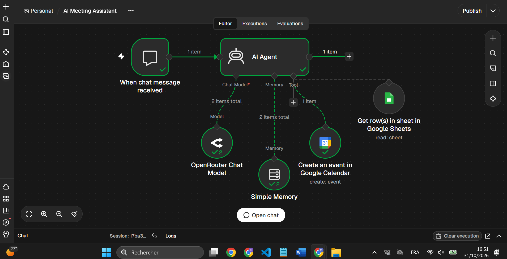

# AI Meeting Assistant — n8n

Assistant conversationnel de préparation de réunions : recherche d’un contact dans Google Sheets, validation des participants dans le chat, puis création d’un événement Google Calendar et envoi d’une invitation.

## Fonctionnement

1. L’utilisateur décrit la réunion dans le chat n8n.
2. L’agent utilise le modèle connecté via OpenRouter pour interpréter le titre, la date, les horaires et le participant ou l’équipe.
3. L’outil Google Sheets lit les colonnes `NOM`, `EMAIL` et `EQUIPE` du répertoire.
4. L’agent présente les informations et demande une confirmation.
5. Après confirmation, Google Calendar crée l’événement avec `sendUpdates: all` pour envoyer l’invitation.

## Technologies

- n8n : orchestration et chat.
- AI Agent : instructions et utilisation des outils.
- OpenRouter Chat Model : accès au modèle (`openrouter/free` dans cet export).
- Simple Memory : contexte de conversation.
- Google Sheets : répertoire de contacts.
- Google Calendar : création et invitation.

## Installation

1. Importer `workflow.json` dans une instance n8n compatible avec les versions de nœuds présentes dans le fichier.
2. Créer ou sélectionner ses propres identifiants OpenRouter, Google Sheets et Google Calendar.
3. Importer `contacts-example.csv` dans Google Sheets et nommer l’onglet `Contacts`. Remplacer les adresses fictives par des comptes de test autorisés avant tout essai d’envoi.
4. Dans Google Sheets Tool, remplacer `YOUR_SPREADSHEET_ID` par son document et vérifier l’onglet sélectionné.
5. Dans Google Calendar Tool, remplacer `YOUR_CALENDAR_ID` par son calendrier accessible en écriture, ou le sélectionner depuis la liste.
6. Vérifier le fuseau `Africa/Casablanca` dans les paramètres du workflow et les instructions de l’agent. Utiliser une base de fuseaux horaires à jour.
7. Ouvrir le chat de test. Le workflow est fourni inactif et n’exige pas de publication pour un essai dans l’éditeur.

L’accès à n8n et aux services externes peut nécessiter un abonnement ou être soumis à des quotas. Le nom du modèle ne constitue pas une garantie de disponibilité ni de gratuité permanente.

## Exemple de demande

> Prépare une réunion « Démo projet » le [date future] de 10h00 à 10h30, heure de Casablanca, avec Sara de l’équipe Commercial. Affiche son nom et son email et attends ma confirmation avant de créer la réunion et d’envoyer l’invitation.

Vérifier le participant et les horaires avant de confirmer une seule fois.

## Validation réalisée

Un essai avec un participant a été réalisé : lecture du répertoire, confirmation dans le chat, création de l’événement et réception de l’invitation à l’adresse attendue. Un second essai a confirmé un créneau de 10h00 à 10h30 dans l’email reçu.

Ces essais ne constituent pas une validation exhaustive. L’export anonymisé n’a pas été exécuté : il nécessite de reconnecter les comptes et de sélectionner ses propres ressources.

## Limites de cette version

- Le champ Attendees contient un seul emplacement dynamique : un participant par événement a été testé. Une équipe de plusieurs personnes n’est pas encore prise en charge de manière fiable.
- La confirmation et la sélection des contacts reposent sur les instructions du modèle, sans contrôle déterministe séparé.
- Aucun outil de consultation des disponibilités, de modification ou de suppression d’événements n’est inclus.
- La conversion des horaires repose encore sur le modèle. Une erreur d’une heure a été observée puis un nouvel essai a réussi après ajustement des instructions. Une conversion déterministe reste à implémenter.
- Pas de mécanisme d’idempotence : ne pas relancer une création sans vérifier si l’événement existe déjà, notamment après un délai réseau.
- La mémoire de conversation n’est pas une base de données métier.
- Prototype de démonstration : authentification des utilisateurs, contrôle des autorisations, audit et gestion robuste des erreurs restent à développer.

## Confidentialité

L’export public retire les références aux identifiants n8n, le calendrier personnel, l’identifiant du tableur et les métadonnées de l’instance. Il ne contient pas de données d’exécution épinglées. Chaque utilisateur reconnecte ses propres comptes.

Ne pas publier de clé API, jeton OAuth, export d’identifiants, email réel, lien privé ni capture affichant des données personnelles. Le fichier d’origine n’est pas destiné à être publié.

## Évolutions prévues

- Plusieurs participants avec vérification explicite des destinataires.
- Conversion des horaires dans une étape déterministe.
- Consultation des disponibilités et prévention des conflits.
- Mise à jour et annulation avec confirmation.
- Journal des opérations et prévention des doublons.

## Contenu du dépôt

- `workflow.json` : workflow anonymisé à configurer.
- `contacts-example.csv` : structure de répertoire avec données fictives.
- `README.md` : présentation, configuration et limites.
- `.gitignore` : exclusions pour les fichiers locaux sensibles.
